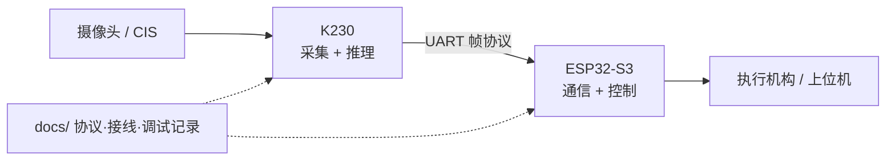

<div align="center">

# ESP32-S3 + K230 边缘 AI 视觉工程

**K230 负责看，ESP32 负责动：一套双板联调的接线、协议与调试记录**


[联调要点](#3-联调要点) · [常见问题](#4-常见问题) · [全部仓库索引](https://github.com/xhtfps/xhtfps)

</div>

## 双板项目真正的难点

不是模型能不能跑，而是**两块板子怎么对上**：谁先启动、帧头怎么定、丢帧了怎么定位、供电不够时为什么是 ESP32 先重启。这个仓库把 K230 侧脚本、ESP32 侧固件、协议文档放在一起，先跑通回环再加视觉。

## 亮点

- **两侧可独立验证**：K230 单独出帧率打印，ESP32 单独 `idf.py monitor`，各自正常后再联调，避免两头猜。
- **协议有文档**：帧头/字段/波特率写在 `K230+ESP32/docs/`，改协议必须两端同改，不靠记忆。
- **定位丢帧有套路**：先「固定字符串回环」，再切图像结果，能把问题锁在链路或算法一侧。
- **整机另有归口**：舞蹈机器人整机已拆到 `dance-robot-esp32`，这里只留双板协作，不再两处维护。

## 结构



## 1. 目录一览

| 目录 | 内容 |
| --- | --- |
| `ESP32/` | ESP-IDF 工程：WiFi/串口通信、数据转发、设备控制 |
| `K230+ESP32/ESP32/` | 双板联调用的 ESP32 工程（与 K230 协议对接版） |
| `K230+ESP32/k230/` | K230 侧脚本（CanMV / MicroPython），摄像头采集、检测、串口发送 |
| `K230+ESP32/docs/` | 通信协议、接线表、调试记录 |

## 2. 环境准备

**ESP32-S3 侧**

- ESP-IDF 5.x（建议 v5.2 以上），安装后激活环境：

```powershell
$env:IDF_PATH="C:\Espressif\frameworks\esp-idf-v5.2"
& "$env:IDF_PATH\export.ps1"
```

- USB 驱动（CH343/CP210x）安装后确认设备管理器出现串口。
- 编译烧录：

```powershell
cd .\ESP32
idf.py set-target esp32s3
idf.py menuconfig        # 按需改 WiFi SSID / 波特率
idf.py build
idf.py -p COMx flash monitor
```

**K230 侧**

- CanMV-K230 固件（MicroPython），插卡启动后通过 IDE 或 REPL 运行 `k230/` 下脚本。
- 摄像头为板载 CIS 或外接 GC2093 类模组，模型文件放 K230 文件系统 `/sdcard/models/`。

## 3. 联调要点

1. 先单独验证两端：K230 能在 IDE 里出帧率打印，ESP32 能 `idf.py monitor` 看到启动日志。
2. 接线：K230 UART → ESP32 UART（TX/RX 交叉、共地），波特率两端一致（常见 115200 / 460800）。
3. 协议字段与帧头尾以 `K230+ESP32/docs/` 为准，改协议要两端同时改。
4. 联合调试时先跑“固定字符串回环”，再切到图像结果，便于定位丢帧。

## 4. 常见问题

- **ESP32 反复重启**：多为供电不足（摄像头/舵机同时工作时尤其明显），改用外部 5V 并共地。
- **K230 帧率低**：降低分辨率或关闭显示叠加；`sensor.set_framesize` 改 QVGA 先验证链路。
- **串口乱码**：波特率不匹配或 TX/RX 未交叉；K230 端注意 3.3V 电平。
- **烧录失败**：按住 BOOT 再上电进入下载模式。

## 5. 维护说明

- 原 `k230-esp32-vision-link`、`dancing-robot-multimodal` 两个仓库已并入本仓库（文件内容逐一比对），原仓库已删除。
- 排除清单已压缩为 [`EXCLUDED_FILES.md`](EXCLUDED_FILES.md) 摘要（原 4.4 MB 逐文件 CSV 已删除，明细存本地）。
- 第三方库与模型授权请单独确认。

## 大文件去哪了

按 `SLIM-PLAN.md` 的口径做体积治理：以下文件**从 HEAD 移出、历史完整保留**。需要时按 `base_commit` 直链下载，不要重新提交进仓。

| 文件 | 体积 | 取回 |
| --- | --- | --- |
| `SourceHanSerifSC-Regular.otf` | 23.3 MB | [blob@34f3f6b](https://github.com/xhtfps/esp32-k230-ai/blob/34f3f6bca7862f828d8aae78b338496f2d07b145/ESP32/lvgl/project/import/font/SourceHanSerifSC-Regular.otf) |

完整台账见 [`notes/offload.json`](https://github.com/xhtfps/notes/blob/main/offload.json)，恢复命令 `python tools/fetch-assets.py --repo esp32-k230-ai`。

## 路线图

- [x] 双板协议、接线表与调试记录整理入库
- [x] 整机工程剥离到 `dance-robot-esp32`，消除重复维护
- [ ] 补一版带时间戳的帧日志解析脚本，便于量化丢帧率
- [ ] 把 UART 协议升级为带校验与重传的版本

## 参与与反馈

- 遇到问题请走 [Issue 模板](.github/ISSUE_TEMPLATE)，注明两侧固件版本与波特率。
- 提 PR 前先读 [CONTRIBUTING.md](CONTRIBUTING.md)；安全问题按 [SECURITY.md](SECURITY.md) 私下反馈。
- 如果这个仓库帮你省过时间，点个 ⭐ 是最省事的支持。

## 许可证

本仓自写代码以 [MIT](LICENSE) 分发；CanMV 固件、ESP-IDF 与所用模型按各自许可证使用。
